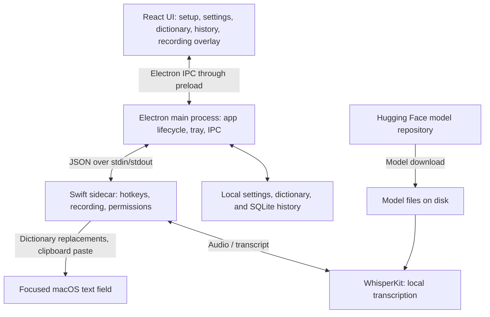

# open-flow

open-flow is a local-first macOS dictation app. Hold a hotkey, speak, and release to paste the transcript into the text field you were already using. Speech is transcribed on your Mac with WhisperKit, without sending audio to a cloud transcription API.

## Features

- Push-to-talk dictation with a configurable hotkey (Right Option by default).
- A recording overlay that shows audio levels and transcription status.
- A custom dictionary for replacing words and phrases in transcripts.
- Local transcript history that can be disabled or deleted.
- A menu bar app with settings, model setup, and permission guidance.

## Architecture

The Electron app manages the interface, tray, settings, dictionary, and history. It starts a Swift sidecar as a child process for global hotkeys, microphone capture, local transcription, and pasting into other apps. They exchange newline-delimited JSON over stdin/stdout.



When you release the hotkey, the sidecar transcribes the recording, applies dictionary replacements, and pastes the result using the clipboard and a simulated Command-V. It then restores the previous clipboard contents. Electron receives the transcript and saves it if history is enabled.

The landing page is a separate Vite app in the same pnpm workspace.

## Requirements

- Apple Silicon Mac with macOS 13 or newer.
- Node.js 22 (22.12.0 or newer) and pnpm 10.33.3 (the versions specified by the workspace).
- Swift 5.10 or newer to build the sidecar.

## Setup

Run from the repository root:

Use Node.js 22 before installing dependencies (`nvm install && nvm use` if you use nvm; the version is specified in `.nvmrc`). The current `better-sqlite3` dependency does not compile with Node.js 26.

```sh
pnpm install
pnpm build:sidecar
pnpm dev
```

Build the sidecar before starting the desktop app. The build script copies and ad-hoc signs the binary at `apps/desktop/resources/bin/open-flow-sidecar`. Rebuild it after changing Swift code.

Dependency installation also rebuilds `better-sqlite3` for Electron. If history reports `ERR_DLOPEN_FAILED` or a `NODE_MODULE_VERSION` mismatch after reinstalling or rebuilding dependencies, stop the desktop app, run `pnpm rebuild:native`, then restart it with `pnpm dev`. A plain Node.js rebuild targets a different runtime than Electron.

On first launch, install a speech model and grant Microphone, Input Monitoring, and Accessibility permissions using the app's setup guidance. Model downloads require internet access; transcription runs locally.

## Commands

```sh
pnpm dev              # run the Electron desktop app
pnpm dev:landing      # run the landing page
pnpm build:sidecar    # build the Swift sidecar
pnpm build:desktop    # build the desktop app
pnpm build:landing    # build the landing page
pnpm rebuild:native   # rebuild better-sqlite3 for Electron
pnpm build            # build all three
pnpm lint             # lint the workspace
pnpm typecheck        # check TypeScript
pnpm test             # run workspace tests
```

Run the Swift tests separately:

```sh
swift test --package-path apps/sidecar
```

## Landing page deployment (Vercel)

Set the Vercel project's **Root Directory** to `apps/landing` and enable
**Include source files outside of the Root Directory in the Build Step** so the
workspace lockfile and shared TypeScript configuration are available. Use Node.js
**22.x** (also pinned in the landing page's `package.json`).

The checked-in `apps/landing/vercel.json` selects Vite, builds only the landing
page, and publishes `dist`. Its filtered, frozen install skips lifecycle scripts
to avoid compiling the desktop app's `better-sqlite3` dependency or running the
workspace's Electron rebuild hook. This override applies only to Vercel; normal
local desktop installs still rebuild native modules.

After pushing these files, redeploy with the build cache disabled once. Do not
use the workspace's root `build` command for this project: it also builds the
macOS sidecar and Electron app.

## Project layout

- `apps/desktop/` — Electron main process, React UI, preload bridge, and local storage.
- `apps/sidecar/` — Swift native functionality and WhisperKit integration; see the [sidecar README](apps/sidecar/README.md).
- `apps/landing/` — Vite landing page.
- `packages/shared/` — Shared TypeScript settings types and IPC contracts.
- `scripts/` — Sidecar build and notarization scripts.

## Local data and privacy

Settings, dictionary entries, transcript history, and downloaded models are stored under `~/Library/Application Support/open-flow/`. Settings and dictionary entries use JSON files; history uses SQLite.

Audio is processed locally. Model loading uses WhisperKit's download/cache flow, so local transcription does not mean the app never accesses the network. You can turn off transcript history in settings or delete saved entries from the History page.
